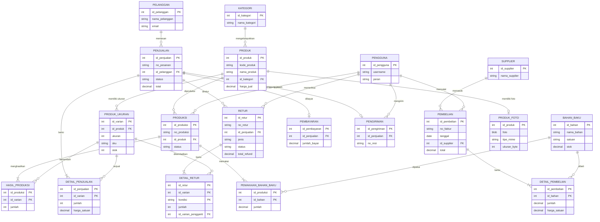

# Rancangan Database HIBISCUS FOOTWEAR

**Nama Sistem:** Sistem Informasi Penjualan dan Produksi HIBISCUS FOOTWEAR
**DBMS:** MySQL 8.0+ / MariaDB 10.4+ (XAMPP)
**Nama database:** `hibiscus_footwear`
**Aplikasi:** PHP 8 native + Bootstrap 5 (folder `app/`): panel admin dan toko online pelanggan

---

## 1. Gambaran Umum

HIBISCUS FOOTWEAR adalah brand sepatu milik sendiri. Perusahaan membeli bahan baku dari supplier, memprosesnya di bagian produksi sendiri, lalu menyimpan produk jadi. Produk jadi kemudian dijual secara online kepada pelanggan.

**Ketentuan bisnis:**

- Produksi dilakukan sendiri.
- Setiap produk memiliki variasi ukuran (36–40), dan stok setiap ukuran dicatat terpisah.
- Penjualan dilakukan secara online melalui website.
- Persediaan bahan baku dan persediaan produk jadi dikelola terpisah.
- Pembayaran dilakukan satu kali dan harus lunas, sebelum pesanan dikirim.
- Setiap transaksi dicatat oleh pengguna (admin/pegawai) yang login ke sistem.
- Pelanggan dapat mengajukan retur paling lambat 7 hari setelah barang diterima, dengan penyelesaian berupa refund atau tukar ukuran.

---

## 2. Perubahan dari Rancangan Awal

| No | Kelemahan rancangan awal | Perbaikan |
|---|---|---|
| 1 | Variasi ukuran tidak punya tempat, sehingga stok per ukuran tidak bisa diketahui | Tambah master **Produk Ukuran** (varian/SKU) dengan kolom `stok` per ukuran |
| 2 | Pembelian tidak punya detail, padahal satu faktur bisa berisi banyak bahan | Tambah transaksi **Detail Pembelian** |
| 3 | Hasil produksi per ukuran tidak tercatat | Tambah transaksi **Hasil Produksi** (jumlah pasang per ukuran) |
| 4 | Satuan bahan baku tidak ada | Tambah atribut `satuan`, `stok_minimum`, dan `harga_terakhir` pada Bahan Baku |
| 5 | Pembayaran dan pengiriman (alur langkah 7–8) tidak punya tempat | Tambah transaksi **Pembayaran** (1 pesanan = 1 pembayaran lunas) dan **Pengiriman** (kurir, resi, tanggal kirim/terima) |
| 6 | Status pesanan dan pembatalan tidak dikelola | Tambah `status` pesanan dengan alur yang dijaga trigger; stok dikembalikan otomatis saat pesanan dibatalkan |
| 7 | Tidak ada entitas pengguna, padahal sistem web membutuhkan login | Tambah master **Pengguna** (admin, gudang, produksi, penjualan) |
| 8 | Tidak ada laporan stok produk jadi, dan produk terlaris tidak dirinci per ukuran | Tambah **Laporan Stok Produk Jadi** dan laporan **Produk Terlaris per Ukuran** |
| 9 | Format dokumen rusak (tabel berantakan, poin menempel) | Dokumen ditulis ulang dalam Markdown yang rapi, ditambah kamus data dan ERD |
| 10 | Harga di detail penjualan bisa ikut berubah ketika harga produk diubah | `harga_satuan` di Detail Penjualan disimpan sebagai **snapshot** saat transaksi |
| 11 | Retur barang tidak ditangani | Tambah transaksi **Retur** dan **Detail Retur** (refund / tukar ukuran, kondisi baik / cacat) beserta **Laporan Retur**; omzet dan produk terlaris dihitung bersih setelah retur |
| 12 | Produk tidak punya gambar | Tambah tabel **Produk Foto**: satu foto per produk disimpan sebagai BLOB, diunggah admin dan ditampilkan di toko |

---

## 3. Daftar Entitas

### 3.1 File Master (8 tabel)

| No | Tabel | Fungsi |
|---|---|---|
| M1 | `kategori` | Pengelompokan jenis sepatu (Sneakers, Heels, dll.) |
| M2 | `produk` | Model sepatu yang diproduksi dan dijual, beserta harga jualnya |
| M3 | `produk_ukuran` | Varian ukuran per produk (SKU) dan **stok produk jadi per ukuran** |
| M4 | `bahan_baku` | Bahan produksi, satuannya, dan **stok bahan baku** |
| M5 | `supplier` | Pemasok bahan baku |
| M6 | `pelanggan` | Pembeli yang terdaftar di website |
| M7 | `pengguna` | Admin/pegawai yang login dan mencatat transaksi |
| M8 | `produk_foto` | Foto utama produk, disimpan sebagai data biner (BLOB) |

### 3.2 File Transaksi (11 tabel)

| No | Tabel | Fungsi | Pengaruh ke stok |
|---|---|---|---|
| T1 | `pembelian` | Header pembelian bahan baku (faktur, tanggal, supplier) | – |
| T2 | `detail_pembelian` | Rincian bahan, jumlah, dan harga per pembelian | Stok bahan **+** |
| T3 | `produksi` | Header satu batch produksi untuk satu produk | – |
| T4 | `pemakaian_bahan_baku` | Bahan yang dipakai pada produksi | Stok bahan **−** |
| T5 | `hasil_produksi` | Jumlah pasang yang dihasilkan per ukuran | Stok produk **+** |
| T6 | `penjualan` | Header pesanan online (pelanggan, status, ongkir, total) | Batal → stok produk dikembalikan |
| T7 | `detail_penjualan` | Produk, ukuran, jumlah, dan harga per pesanan | Stok produk **−** |
| T8 | `pembayaran` | Pembayaran lunas satu kali per pesanan | – |
| T9 | `pengiriman` | Kurir, nomor resi, tanggal kirim dan terima | – |
| T10 | `retur` | Header pengajuan retur (pesanan, jenis refund/tukar, alasan, status) | Diterima → stok diproses |
| T11 | `detail_retur` | Ukuran yang dikembalikan, kondisi, jumlah, ukuran pengganti | Baik → stok **+**; pengganti → stok **−** |

### 3.3 File Report (7 laporan)

Laporan tidak dibuat sebagai tabel. Laporan dihasilkan oleh **VIEW** dan **STORED PROCEDURE** dari data master dan transaksi.

| No | Laporan | VIEW | Procedure (filter periode) |
|---|---|---|---|
| 1 | Laporan Pembelian | `v_laporan_pembelian`, `v_rekap_pembelian_bulanan` | `sp_laporan_pembelian(awal, akhir, id_supplier)` |
| 2 | Laporan Stok Bahan Baku | `v_laporan_stok_bahan_baku` | – |
| 3 | Laporan Stok Produk Jadi | `v_laporan_stok_produk` | – |
| 4 | Laporan Produksi | `v_laporan_produksi`, `v_rekap_produksi_bulanan` | `sp_laporan_produksi(awal, akhir)` |
| 5 | Laporan Penjualan | `v_laporan_penjualan`, `v_rekap_penjualan_bulanan` | `sp_laporan_penjualan(awal, akhir)` |
| 6 | Laporan Produk Terlaris | `v_produk_terlaris`, `v_produk_terlaris_per_ukuran` | `sp_produk_terlaris(awal, akhir, jumlah)` |
| 7 | Laporan Retur | `v_laporan_retur`, `v_rekap_retur_bulanan` | `sp_laporan_retur(awal, akhir)` |

- Omzet dan produk terlaris hanya menghitung pesanan berstatus `dibayar`, `dikirim`, atau `selesai`. Pesanan yang belum dibayar atau dibatalkan tidak dihitung.
- **Omzet bersih** = omzet − refund. Refund dicatat pada bulan retur berstatus `selesai`, yaitu saat uang dikembalikan.
- **Produk terlaris** dihitung bersih. Barang yang diretur (status `diterima`/`selesai`) dikurangkan, dan ukuran pengganti hasil tukar ikut dihitung sebagai terjual. Perhitungan ini memakai view bantu `v_mutasi_penjualan`.

---

## 4. Kamus Data

Keterangan: **PK** = primary key, **FK** = foreign key, **UQ** = unik, **AI** = auto increment.

### M1. `kategori`
| Kolom | Tipe | Keterangan |
|---|---|---|
| id_kategori | INT UNSIGNED | PK, AI |
| nama_kategori | VARCHAR(50) | UQ, wajib |
| deskripsi | VARCHAR(255) | opsional |

### M2. `produk`
| Kolom | Tipe | Keterangan |
|---|---|---|
| id_produk | INT UNSIGNED | PK, AI |
| kode_produk | VARCHAR(20) | UQ, contoh `SNK-001` |
| nama_produk | VARCHAR(100) | wajib |
| id_kategori | INT UNSIGNED | FK → kategori |
| deskripsi | TEXT | opsional |
| harga_jual | DECIMAL(12,2) | ≥ 0 |
| aktif | TINYINT(1) | 1 = masih dijual |
| dibuat_pada | TIMESTAMP | otomatis |

### M3. `produk_ukuran`
| Kolom | Tipe | Keterangan |
|---|---|---|
| id_varian | INT UNSIGNED | PK, AI |
| id_produk | INT UNSIGNED | FK → produk |
| ukuran | TINYINT UNSIGNED | 30–50; UQ bersama id_produk |
| sku | VARCHAR(30) | UQ, contoh `SNK-001-38` |
| stok | INT | ≥ 0, **diperbarui otomatis oleh trigger** |
| stok_minimum | INT | batas peringatan stok menipis |

### M4. `bahan_baku`
| Kolom | Tipe | Keterangan |
|---|---|---|
| id_bahan | INT UNSIGNED | PK, AI |
| kode_bahan | VARCHAR(20) | UQ |
| nama_bahan | VARCHAR(100) | wajib |
| satuan | VARCHAR(15) | meter, pasang, liter, gulung, pcs |
| stok | DECIMAL(12,2) | ≥ 0, **diperbarui otomatis oleh trigger** |
| stok_minimum | DECIMAL(12,2) | batas peringatan |
| harga_terakhir | DECIMAL(12,2) | harga dari pembelian terakhir (otomatis) |

### M5. `supplier`
| Kolom | Tipe | Keterangan |
|---|---|---|
| id_supplier | INT UNSIGNED | PK, AI |
| nama_supplier | VARCHAR(100) | wajib |
| kontak_person | VARCHAR(100) | opsional |
| no_telepon | VARCHAR(20) | wajib |
| email | VARCHAR(100) | opsional |
| alamat, kota | VARCHAR | wajib |
| aktif | TINYINT(1) | 1 = masih bekerja sama |

### M6. `pelanggan`
| Kolom | Tipe | Keterangan |
|---|---|---|
| id_pelanggan | INT UNSIGNED | PK, AI |
| nama_pelanggan | VARCHAR(100) | wajib |
| email | VARCHAR(100) | UQ (dipakai untuk login website) |
| password_hash | VARCHAR(255) | hash bcrypt untuk login toko (ditambahkan oleh `08_akun_pelanggan.sql`) |
| no_hp | VARCHAR(20) | wajib |
| alamat, kota, kode_pos | VARCHAR | alamat utama |
| terdaftar_pada | TIMESTAMP | otomatis |

### M7. `pengguna`
| Kolom | Tipe | Keterangan |
|---|---|---|
| id_pengguna | INT UNSIGNED | PK, AI |
| username | VARCHAR(30) | UQ |
| password_hash | VARCHAR(255) | hash password, **bukan** password asli |
| nama_lengkap | VARCHAR(100) | wajib |
| peran | ENUM | admin, gudang, produksi, penjualan |
| aktif | TINYINT(1) | 1 = akun aktif |

### M8. `produk_foto` (file `09_foto_produk.sql`)
| Kolom | Tipe | Keterangan |
|---|---|---|
| id_produk | INT UNSIGNED | PK, FK → produk (ON DELETE CASCADE); satu foto per produk |
| foto | MEDIUMBLOB | isi file gambar dalam bentuk **biner** |
| tipe_mime | VARCHAR(30) | `image/jpeg`, `image/png`, atau `image/webp` (CHECK) |
| ukuran_byte | INT UNSIGNED | 1 – 921.600 byte (maks. 900 KB, CHECK) |
| lebar, tinggi | SMALLINT UNSIGNED | dimensi gambar dalam piksel |
| diunggah_pada | TIMESTAMP | otomatis; dipakai juga sebagai versi cache gambar |

Foto dipisah dari tabel `produk` agar query katalog tidak ikut membaca data biner yang besar. Aplikasi membaca BLOB lewat `app/foto.php?id=<id_produk>` dan mengirimnya ke browser dengan `Content-Type` sesuai `tipe_mime`. Batas 900 KB mengikuti `max_allowed_packet` bawaan XAMPP (1 MB); foto besar dikecilkan di browser sebelum diunggah.

### T1. `pembelian`
| Kolom | Tipe | Keterangan |
|---|---|---|
| id_pembelian | INT UNSIGNED | PK, AI |
| no_faktur | VARCHAR(30) | UQ |
| tanggal | DATE | wajib |
| id_supplier | INT UNSIGNED | FK → supplier |
| id_pengguna | INT UNSIGNED | FK → pengguna (pencatat) |
| total | DECIMAL(14,2) | **otomatis** = Σ subtotal detail |
| keterangan | VARCHAR(255) | opsional |

### T2. `detail_pembelian`
| Kolom | Tipe | Keterangan |
|---|---|---|
| id_pembelian | INT UNSIGNED | PK, FK → pembelian |
| id_bahan | INT UNSIGNED | PK, FK → bahan_baku |
| jumlah | DECIMAL(12,2) | > 0 |
| harga_satuan | DECIMAL(12,2) | ≥ 0 |
| subtotal | DECIMAL(14,2) | kolom terhitung = jumlah × harga_satuan |

### T3. `produksi`
| Kolom | Tipe | Keterangan |
|---|---|---|
| id_produksi | INT UNSIGNED | PK, AI |
| no_produksi | VARCHAR(30) | UQ |
| id_produk | INT UNSIGNED | FK → produk |
| tanggal_mulai | DATE | wajib |
| tanggal_selesai | DATE | ≥ tanggal_mulai; otomatis hari ini jika kosong saat selesai |
| status | ENUM | `proses`, `selesai` |
| id_pengguna | INT UNSIGNED | FK → pengguna (penanggung jawab) |
| catatan | VARCHAR(255) | opsional |

### T4. `pemakaian_bahan_baku`
| Kolom | Tipe | Keterangan |
|---|---|---|
| id_produksi | INT UNSIGNED | PK, FK → produksi |
| id_bahan | INT UNSIGNED | PK, FK → bahan_baku |
| jumlah | DECIMAL(12,2) | > 0, tidak boleh melebihi stok |

### T5. `hasil_produksi`
| Kolom | Tipe | Keterangan |
|---|---|---|
| id_produksi | INT UNSIGNED | PK, FK → produksi |
| id_varian | INT UNSIGNED | PK, FK → produk_ukuran (harus milik produk yang diproduksi) |
| jumlah | INT | > 0 (pasang) |

### T6. `penjualan`
| Kolom | Tipe | Keterangan |
|---|---|---|
| id_penjualan | INT UNSIGNED | PK, AI |
| no_pesanan | VARCHAR(30) | UQ |
| tanggal_pesan | DATETIME | default waktu sekarang |
| id_pelanggan | INT UNSIGNED | FK → pelanggan |
| status | ENUM | `menunggu_pembayaran`, `dibayar`, `dikirim`, `selesai`, `dibatalkan` |
| alamat_kirim | VARCHAR(255) | snapshot alamat saat memesan |
| subtotal | DECIMAL(14,2) | **otomatis** = Σ subtotal detail |
| ongkir | DECIMAL(12,2) | ≥ 0 |
| total | DECIMAL(14,2) | kolom terhitung = subtotal + ongkir |
| catatan | VARCHAR(255) | opsional |

### T7. `detail_penjualan`
| Kolom | Tipe | Keterangan |
|---|---|---|
| id_penjualan | INT UNSIGNED | PK, FK → penjualan |
| id_varian | INT UNSIGNED | PK, FK → produk_ukuran (produk + ukuran) |
| jumlah | INT | > 0, tidak boleh melebihi stok |
| harga_satuan | DECIMAL(12,2) | snapshot; jika diisi NULL otomatis = harga_jual produk |
| subtotal | DECIMAL(14,2) | kolom terhitung = jumlah × harga_satuan |

### T8. `pembayaran`
| Kolom | Tipe | Keterangan |
|---|---|---|
| id_pembayaran | INT UNSIGNED | PK, AI |
| id_penjualan | INT UNSIGNED | FK → penjualan, **UQ** (hanya satu kali bayar) |
| tanggal_bayar | DATETIME | default waktu sekarang |
| metode | ENUM | transfer_bank, e_wallet, qris, kartu_kredit |
| jumlah_bayar | DECIMAL(14,2) | **harus sama dengan total** (lunas) |
| no_referensi | VARCHAR(50) | nomor bukti transaksi |

### T9. `pengiriman`
| Kolom | Tipe | Keterangan |
|---|---|---|
| id_pengiriman | INT UNSIGNED | PK, AI |
| id_penjualan | INT UNSIGNED | FK → penjualan, UQ |
| kurir, layanan | VARCHAR(30) | contoh JNE REG |
| no_resi | VARCHAR(50) | UQ bersama kurir |
| tanggal_kirim | DATE | wajib |
| tanggal_terima | DATE | diisi saat pesanan diterima, ≥ tanggal_kirim |
| id_pengguna | INT UNSIGNED | FK → pengguna (petugas kirim) |

### T10. `retur`
| Kolom | Tipe | Keterangan |
|---|---|---|
| id_retur | INT UNSIGNED | PK, AI |
| no_retur | VARCHAR(30) | UQ |
| id_penjualan | INT UNSIGNED | FK → penjualan (harus berstatus `selesai`) |
| tanggal_pengajuan | DATE | maksimal 7 hari setelah `pengiriman.tanggal_terima` |
| jenis | ENUM | `refund`, `tukar` |
| alasan | VARCHAR(255) | wajib |
| status | ENUM | `diajukan`, `diterima`, `ditolak`, `selesai` |
| total_refund | DECIMAL(14,2) | **otomatis** = Σ subtotal detail (jenis refund); 0 untuk tukar |
| tanggal_selesai | DATE | otomatis hari ini jika kosong saat selesai |
| id_pengguna | INT UNSIGNED | FK → pengguna (petugas pemeriksa), wajib saat diterima |
| catatan | VARCHAR(255) | opsional |

### T11. `detail_retur`
| Kolom | Tipe | Keterangan |
|---|---|---|
| id_retur | INT UNSIGNED | PK, FK → retur |
| id_varian | INT UNSIGNED | PK, FK → produk_ukuran (harus ada di pesanan) |
| kondisi | ENUM | PK; `baik` (kembali ke stok) atau `cacat` (tidak kembali ke stok) |
| jumlah | INT | > 0; total retur kumulatif ≤ jumlah dibeli |
| harga_satuan | DECIMAL(12,2) | otomatis = harga saat dibeli |
| subtotal | DECIMAL(14,2) | kolom terhitung = jumlah × harga_satuan |
| id_varian_pengganti | INT UNSIGNED | FK → produk_ukuran; wajib jika `tukar`, harus produk yang sama |

---

## 5. Relasi dan ERD

| Relasi | Kardinalitas |
|---|---|
| kategori – produk | 1 : N |
| produk – produk_ukuran | 1 : N |
| supplier – pembelian | 1 : N |
| pembelian – detail_pembelian – bahan_baku | M : N (melalui detail) |
| produk – produksi | 1 : N |
| produksi – pemakaian_bahan_baku – bahan_baku | M : N (melalui pemakaian) |
| produksi – hasil_produksi – produk_ukuran | M : N (melalui hasil) |
| pelanggan – penjualan | 1 : N |
| penjualan – detail_penjualan – produk_ukuran | M : N (melalui detail) |
| penjualan – pembayaran | 1 : 0..1 |
| penjualan – pengiriman | 1 : 0..1 |
| produk – produk_foto | 1 : 0..1 |
| penjualan – retur | 1 : N |
| retur – detail_retur – produk_ukuran | M : N (melalui detail; ditambah relasi ke ukuran pengganti) |
| pengguna – pembelian / produksi / pengiriman | 1 : N |



---

## 6. Alur Proses Bisnis dan Tabel yang Terlibat

| No | Proses | Tabel | Otomatis oleh database |
|---|---|---|---|
| 1 | Membeli bahan baku dari supplier | `pembelian`, `detail_pembelian` | Total faktur dihitung |
| 2 | Bahan yang diterima menjadi persediaan | `bahan_baku` | Stok bahan bertambah, harga terakhir diperbarui |
| 3 | Produksi memakai bahan baku | `produksi`, `pemakaian_bahan_baku` | Stok bahan berkurang; ditolak jika stok kurang |
| 4 | Sepatu jadi dicatat per ukuran | `hasil_produksi` → status `selesai` | Stok produk per ukuran bertambah |
| 5 | Pelanggan memesan lewat website | `penjualan`, `detail_penjualan` | Harga dikunci, subtotal/total dihitung, stok berkurang |
| 6 | Pelanggan membayar lunas | `pembayaran` | Ditolak jika tidak lunas; status → `dibayar` |
| 7 | Pesanan dikirim | `pengiriman` | Ditolak jika belum dibayar; status → `dikirim` |
| 8 | Pesanan diterima | `pengiriman.tanggal_terima` | Status → `selesai` |
| 9 | Pesanan dibatalkan (sebelum dikirim) | `penjualan.status = 'dibatalkan'` | Stok produk dikembalikan |
| 10 | Pelanggan mengajukan retur (≤ 7 hari) | `retur`, `detail_retur` | Validasi pesanan, batas waktu, jumlah; harga & refund dihitung |
| 11 | Gudang menerima barang retur | `retur.status = 'diterima'` | Barang baik → stok +; ukuran pengganti → stok − |
| 12 | Refund ditransfer / pengganti dikirim | `retur.status = 'selesai'` | Refund mengurangi omzet bulan itu |
| 13 | Membuat laporan | VIEW dan PROCEDURE | – |

**Alur status pesanan:**

```
menunggu_pembayaran ──bayar──> dibayar ──kirim──> dikirim ──diterima──> selesai
        │                         │
        └──────── batal ──────────┴──> dibatalkan (stok dikembalikan)
```

**Alur status retur** (hanya untuk pesanan `selesai`, maksimal 7 hari setelah diterima):

```
diajukan ──periksa──> diterima ──refund/kirim pengganti──> selesai
    │
    └──────────────> ditolak (stok tidak berubah)
```

---

## 7. Aturan Integritas (Trigger & Constraint)

1. **Stok tidak pernah negatif.** Ada `CHECK (stok >= 0)` ditambah pengecekan di trigger yang memberi pesan jelas.
2. **Stok selalu konsisten.** Stok hanya berubah lewat transaksi. Baris detail transaksi tidak boleh di-UPDATE; untuk memperbaiki, baris dihapus lalu diinput ulang.
3. **Pembayaran satu kali dan lunas.** `id_penjualan` bersifat UNIQUE dan `jumlah_bayar` harus sama dengan `total`. Data pembayaran tidak boleh diubah atau dihapus.
4. **Alur status pesanan dijaga.** Status tidak bisa melompat, misalnya dari `menunggu_pembayaran` langsung ke `selesai`. Pesanan yang sudah dikirim tidak bisa dibatalkan.
5. **Item pesanan terkunci setelah dibayar.** Item tidak bisa ditambah atau dihapus setelah pesanan dibayar.
6. **Produksi valid.** Ukuran yang dicatat harus milik produk yang diproduksi. Produksi hanya bisa `selesai` jika pemakaian bahan dan hasil sudah dicatat. Produksi yang sudah selesai tidak bisa dibuka kembali.
7. **Retur terkendali.** Retur hanya untuk pesanan `selesai`, paling lambat 7 hari setelah diterima, dengan jumlah kumulatif tidak melebihi yang dibeli. Tukar hanya boleh ke ukuran lain dari produk yang sama, dan stok ukuran pengganti harus cukup. Retur yang sudah diproses tidak bisa diubah atau dihapus.
8. **Data master yang dipakai transaksi tidak bisa dihapus.** Semua foreign key memakai `ON DELETE RESTRICT`; untuk menonaktifkan produk, kolom `aktif` diubah ke 0.

---

## 8. Catatan Perancangan

- **Stok disimpan, bukan dihitung saat dibutuhkan.** Nilai stok di `bahan_baku` dan `produk_ukuran` dijaga oleh trigger. Laporan jadi cepat, dan kebenarannya dibuktikan oleh uji konsistensi di `99_uji_coba.sql` (stok tersimpan = hasil hitung ulang dari semua transaksi).
- **Stok produk dikurangi saat pesanan dibuat,** bukan saat dibayar, supaya barang yang sedang dipesan tidak bisa dibeli orang lain. Jika pesanan dibatalkan, stok dikembalikan.
- **Retur tidak mengubah status pesanan.** Pesanan tetap `selesai`; riwayat retur dilihat di `v_laporan_retur` dan kolom `refund` pada `v_laporan_penjualan`.
- **Tukar ukuran tidak mengubah pendapatan,** karena harga ukuran pengganti sama (produk yang sama). Penukaran ke produk lain yang harganya berbeda belum didukung.
